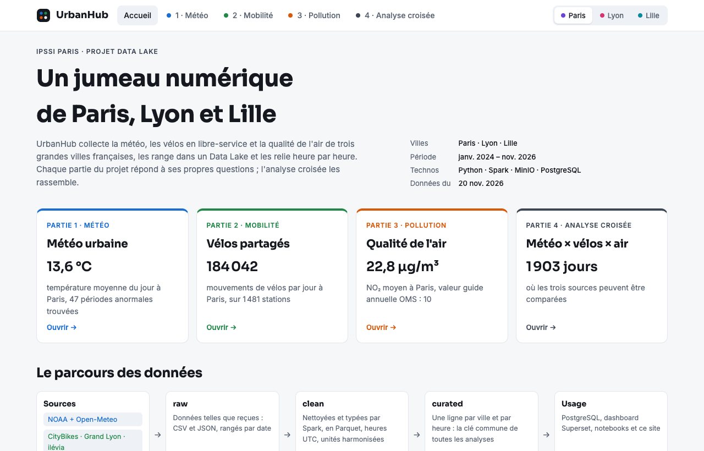
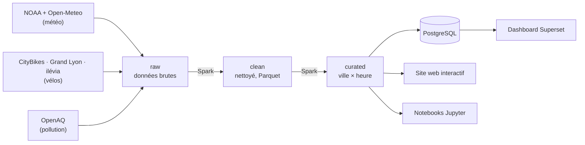
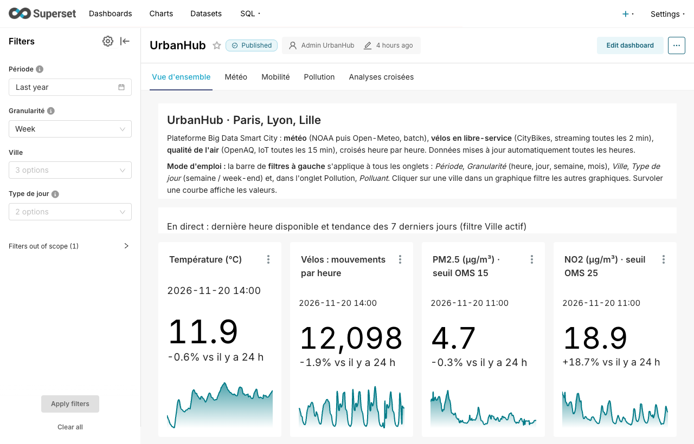
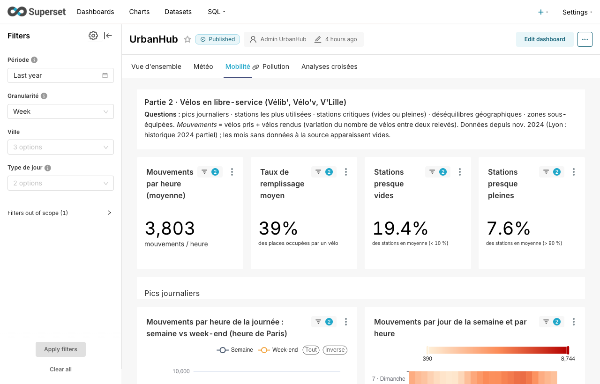
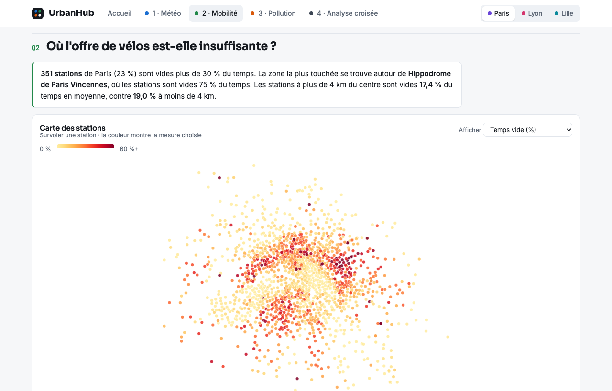
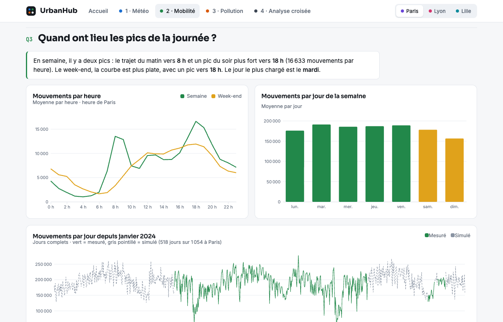
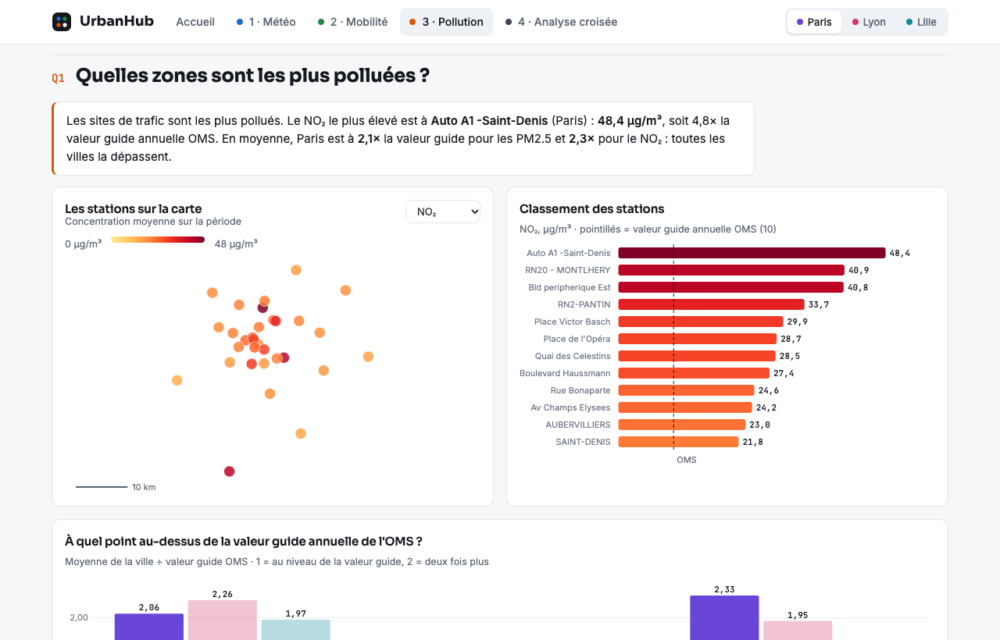
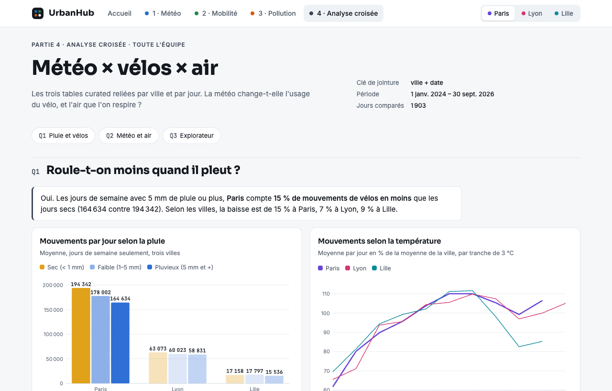

# UrbanHub · jumeau numérique de Paris, Lyon et Lille

> Plateforme Big Data qui collecte **la météo, les vélos en libre-service et la qualité de l'air**,
> les range dans un **Data Lake** et les relie **heure par heure** pour analyser la ville.



| | Météo | Vélos | Pollution |
|---|---|---|---|
| **Responsable** | Développeur 1 | Développeur 2 | Développeur 3 (+ analyses croisées) |
| **Type de flux** | Batch | Streaming (toutes les 2 min) | IoT (toutes les 15 min) |
| **Source** | NOAA Global Hourly, puis Open-Meteo | CityBikes API v2, historique Vélo'v (Lyon), trajets V'Lille | OpenAQ API v3 (stations EEA) |
| **Période** | janv. 2024 → aujourd'hui | Lyon : janv. 2024 → aujourd'hui · Paris, Lille : nov. 2024 → aujourd'hui ¹ | janv. 2024 → aujourd'hui |

¹ Pour Paris (Vélib') et Lille (V'Lille), aucune source publique ne fournit l'historique avant novembre 2024
(voir [`docs/decisions.md`](docs/decisions.md)).

---

## Sommaire

1. [Comment circulent les données](#1-comment-circulent-les-données)
2. [Captures d'écran](#2-captures-décran)
3. [Démarrage rapide](#3-démarrage-rapide)
4. [Adresses des services](#4-adresses-des-services)
5. [Organisation du dépôt](#5-organisation-du-dépôt)
6. [Collecte en continu](#6-collecte-en-continu)
7. [Règles de l'équipe](#7-règles-de-léquipe)

---

## 1. Comment circulent les données



| Couche | Contenu | Format |
|---|---|---|
| **raw** | données telles que reçues des API | CSV, JSON |
| **clean** | nettoyées, typées, heures en UTC, unités harmonisées | Parquet |
| **curated** | une ligne par **ville et par heure** : la clé commune de toutes les analyses | Parquet + PostgreSQL |

Le Data Lake est stocké dans **MinIO** (un bucket par couche). Les règles communes (noms de colonnes,
unités, villes) sont dans [`docs/data_contract.md`](docs/data_contract.md).

---

## 2. Captures d'écran

### Dashboard Superset · 5 onglets, 78 graphiques

| Vue d'ensemble | Mobilité |
|---|---|
|  |  |

### Site web · une page par partie, des graphiques interactifs

| Carte des stations vélo | Pics de la journée |
|---|---|
|  |  |

| Qualité de l'air | Analyse croisée météo × vélos × air |
|---|---|
|  |  |

Résultats détaillés par partie : [météo](docs/resultats/partie1_meteo.md) ·
[vélos](docs/dev2_citybikes.md) · figures dans [`docs/resultats/figures/`](docs/resultats/figures/).

---

## 3. Démarrage rapide

**Prérequis :** Git, Docker Desktop (démarré), environ 10 Go libres.

```bash
# 1. Récupérer le projet
git clone https://github.com/aminekaoutar/UrbanHub.git && cd UrbanHub
cp .env.example .env                     # Windows : copy .env.example .env

# 2. Lancer l'infrastructure (10 à 20 min la première fois)
docker compose -f infra/docker-compose.yml --env-file .env up -d --build

# 3. Vérifier que tout marche
docker compose -f infra/docker-compose.yml --env-file .env exec jupyter python3 infra/check_infra.py
```

**Ouvrir le site web interactif** (sur le PC, avec Python 3.11) :

```bash
python3.11 -m venv .venv && .venv/bin/pip install -r requirements.txt
.venv/bin/python -m dashboard.webapp      # puis http://127.0.0.1:8000
```

**Arrêter :** `docker compose -f infra/docker-compose.yml --env-file .env down`
(les données restent ; ajouter `-v` efface aussi MinIO et PostgreSQL).

> 💡 Un port est déjà pris sur votre machine (5432, 9000…) ? Ajoutez un petit fichier qui change les ports
> et lancez avec `-f infra/docker-compose.yml -f infra/ports.local.yml`.

---

## 4. Adresses des services

| Service | Adresse | Identifiants |
|---|---|---|
| **Superset** (dashboard) | http://localhost:8088/superset/dashboard/urbanhub/ | `admin` / `admin` |
| **Site web interactif** | http://127.0.0.1:8000 | — |
| **MinIO** (Data Lake) | http://localhost:9001 | `urbanhub` / `urbanhub123` |
| **Jupyter Lab** (notebooks, jobs Spark) | http://localhost:8888 | — |
| **Spark** master / worker | http://localhost:8080 · http://localhost:8081 | — |
| **PostgreSQL** | `localhost:5432`, base `urbanhub` | `urbanhub` / `urbanhub123` |

**Où lancer quoi ?**
- **Jobs Spark et notebooks** : dans le conteneur `jupyter` (projet monté dans `/app`), pas besoin d'installer
  Java ni Spark sur le PC.
- **Collecteurs et site web** : sur le PC, avec le Python local.

---

## 5. Organisation du dépôt

```
infra/            Docker : MinIO, Spark, PostgreSQL, Superset, Jupyter
common/           code partagé : configuration, Spark, stockage, publication PostgreSQL, villes, schémas
pipelines/
  batch_noaa/            Dev 1 · météo (téléchargement NOAA, Open-Meteo, clean, curate)
  streaming_citybikes/   Dev 2 · vélos (collecteur, historique, clean, curate, trajets V'Lille)
  iot_openaq/            Dev 3 · pollution (collecteur, clean, curate) + table croisée
analysis/         notebooks des parties 1 à 4
dashboard/
  superset/       dashboard Superset décrit en code
  webapp/         site web interactif (FastAPI + DuckDB)
docs/             guide de l'équipe, contrat de données, décisions, résultats, captures
tests/            tests (contrat de données, pipelines, site web)
```

| Document | Contenu |
|---|---|
| [`docs/UrbanHub_Guide_Coordination.pdf`](docs/UrbanHub_Guide_Coordination.pdf) | rôles, étapes, contrat de données |
| [`docs/data_contract.md`](docs/data_contract.md) | colonnes, unités, villes communes |
| [`docs/decisions.md`](docs/decisions.md) | toutes les décisions de l'équipe |
| [`docs/dev2_citybikes.md`](docs/dev2_citybikes.md) | détail de la partie vélos |
| [`dashboard/webapp/README.md`](dashboard/webapp/README.md) · [`dashboard/superset/README.md`](dashboard/superset/README.md) | site web et dashboard |

---

## 6. Collecte en continu

Sur la machine de démo, trois services tournent en continu et redémarrent seuls :

| Service | Rôle |
|---|---|
| `collecte-velos` | collecteur CityBikes (Dev 2), toutes les 2 min → `raw/citybikes/` |
| `collecte-pollution` | collecteur OpenAQ (Dev 3), toutes les 15 min → `raw/openaq/` |
| `pipeline` | toutes les heures : météo, puis clean → curated → PostgreSQL pour chaque source |

```bash
docker compose -f infra/docker-compose.yml --env-file .env --profile collecte up -d          # allumer
docker compose -f infra/docker-compose.yml --env-file .env --profile collecte logs -f pipeline  # suivre
docker compose -f infra/docker-compose.yml --env-file .env --profile collecte stop collecte-velos collecte-pollution pipeline  # arrêter
```

---

## 7. Règles de l'équipe

- On ne pousse **jamais directement sur `main`** : une branche par tâche (`dev1/…`, `dev2/…`, `dev3/…`, `common/…`),
  puis une pull request relue par l'équipe.
- **Jamais** de données, de clé API ni de fichier `.env` dans Git.
- Toute décision qui touche les trois parties est notée dans [`docs/decisions.md`](docs/decisions.md).
