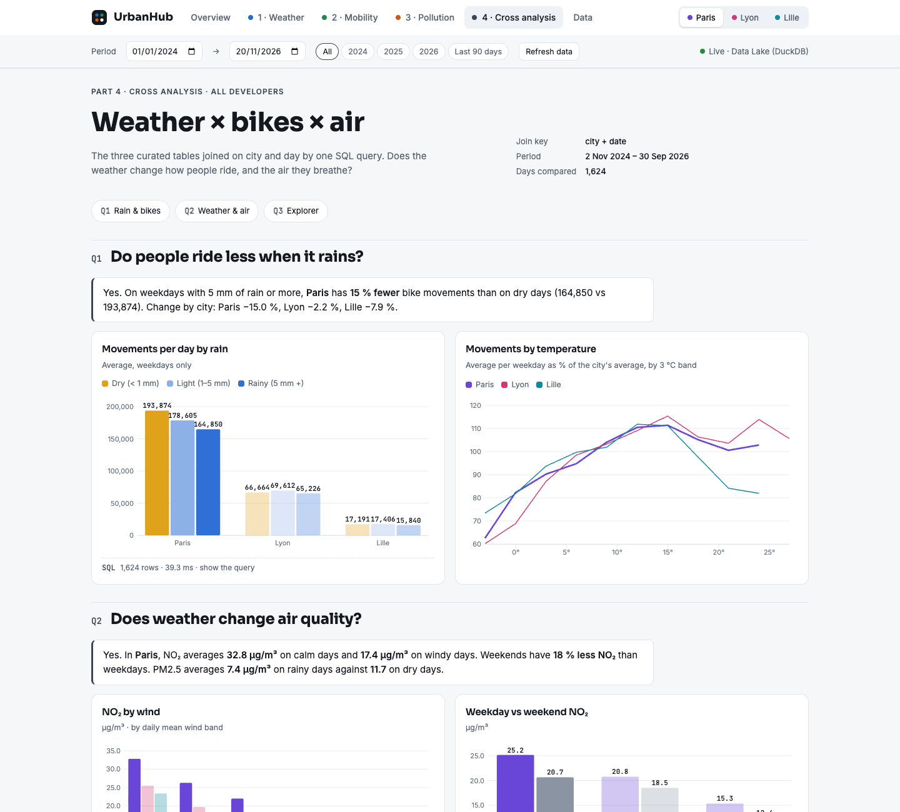
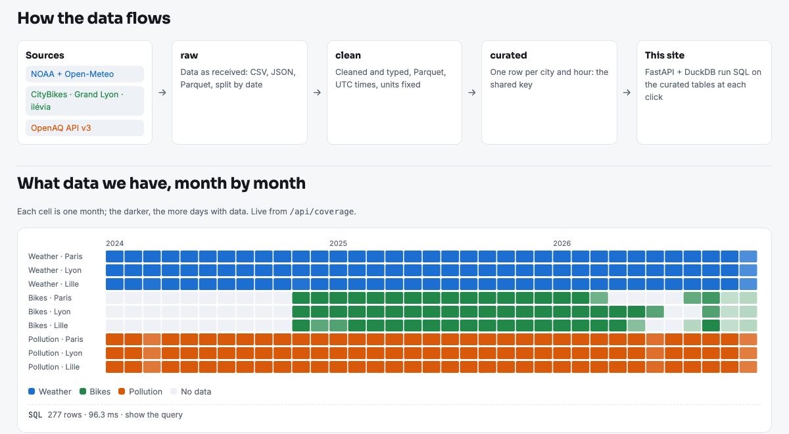
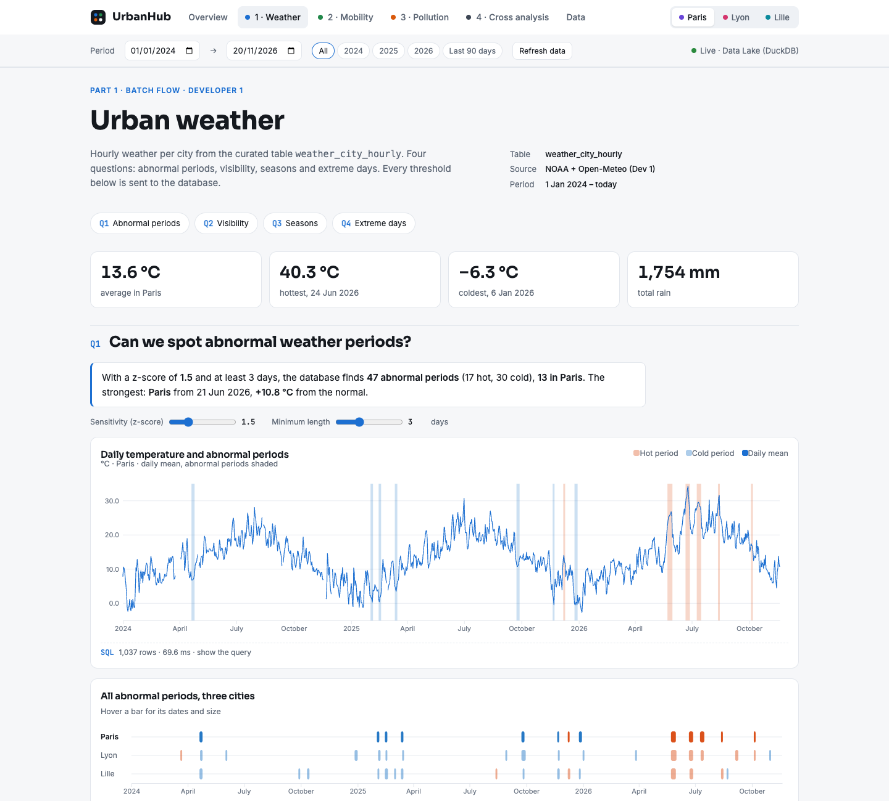
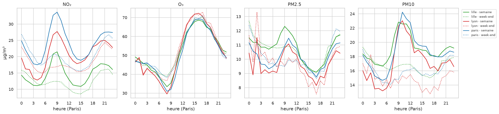
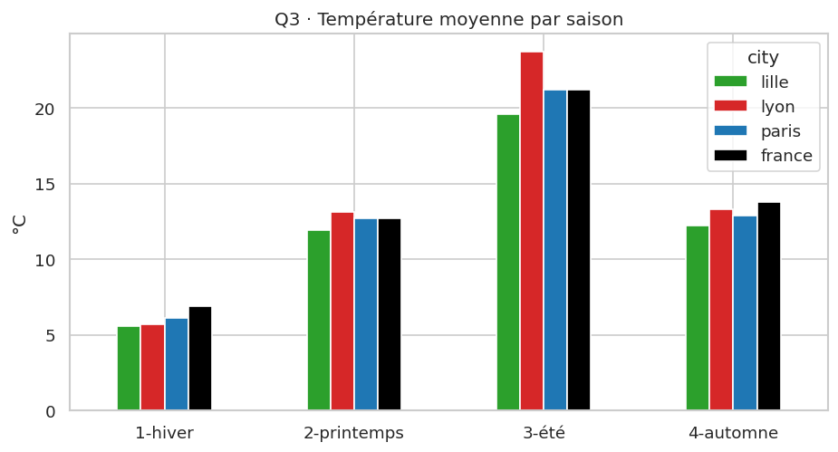
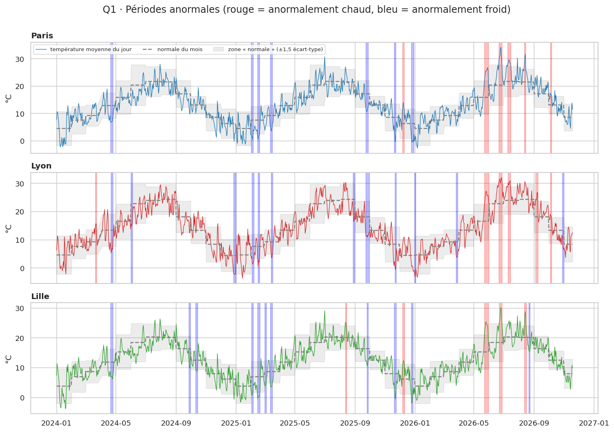
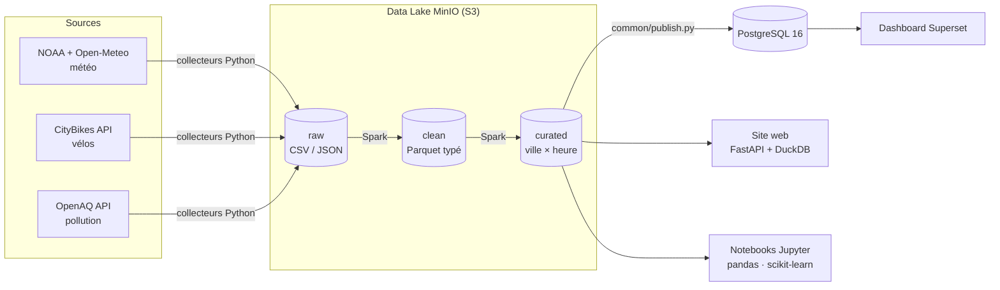

# UrbanHub

**Jumeau numérique urbain de Paris, Lyon et Lille.**
UrbanHub est une plateforme Big Data qui collecte en continu la **météo**, les **vélos en libre-service**
et la **qualité de l'air**, les range dans un Data Lake en trois couches, les croise heure par heure
et les rend explorables dans un dashboard Superset et un site web interactif.

Période étudiée : **janvier 2024 → aujourd'hui (2026)** · Projet Data Lake, IPSSI Paris.



---

## Sommaire

1. [Ce que fait le projet](#ce-que-fait-le-projet)
2. [Aperçu](#aperçu)
3. [Architecture](#architecture)
4. [Sources de données](#sources-de-données)
5. [Data Lake et tables](#data-lake-et-tables)
6. [Démarrage rapide](#démarrage-rapide)
7. [Lancer les traitements](#lancer-les-traitements)
8. [Visualiser les résultats](#visualiser-les-résultats)
9. [Analyses et résultats](#analyses-et-résultats)
10. [Organisation du dépôt](#organisation-du-dépôt)
11. [Tests](#tests)
12. [Équipe et règles de travail](#équipe-et-règles-de-travail)

---

## Ce que fait le projet

| Question | Réponse d'UrbanHub |
|---|---|
| Quel temps fait-il, et quelles périodes sont anormales ? | Météo horaire par ville, détection d'anomalies (z-score), jours extrêmes, saisons |
| Comment les habitants utilisent-ils les vélos ? | État de chaque station Vélib', Vélo'v et V'Lille, pics, déséquilibres, stations à rééquilibrer |
| L'air est-il pollué, quand et où ? | PM2.5, PM10, NO₂, O₃ des stations officielles, comparés aux seuils OMS 2021 |
| La météo change-t-elle les déplacements et l'air ? | Jointure des trois flux sur `(city, timestamp)` : pluie × vélos, vent × NO₂, corrélations |

Trois flux, trois modes d'ingestion :

| Flux | Mode | Source | Fréquence |
|---|---|---|---|
| Météo | **Batch** | NOAA Global Hourly (2024 → 24/08/2025), puis Open-Meteo | toutes les heures |
| Vélos | **Streaming** | CityBikes API v2 + historiques data.citybik.es, Métropole de Lyon, ilévia | toutes les 2-3 min |
| Pollution | **IoT** | OpenAQ API v3 (stations officielles EEA) | toutes les 15 min |

## Aperçu

| Vue d'ensemble : chaîne de données et couverture mois par mois | Météo : périodes anormales détectées en direct |
|---|---|
|  |  |

| Pollution : profil journalier des polluants (semaine / week-end) |
|---|
|  |

| Météo : température moyenne par saison | Météo : périodes anormales (notebook) |
|---|---|
|  |  |

> Captures du site web (`dashboard/webapp`) prises sur les données réelles du Data Lake (novembre 2026).

## Architecture



| Brique | Technologie | Rôle |
|---|---|---|
| Collecte | Python (`requests`, `aiohttp`) | appels d'API, écriture brute dans `raw` |
| Stockage | MinIO (compatible S3, accès `s3a://`) | Data Lake, un bucket par couche |
| Traitement | Spark 3.5 (PySpark) | nettoyage, typage, agrégats ville × heure |
| Serving | PostgreSQL 16 | tables curated pour le dashboard |
| Visualisation | Superset 5 · FastAPI + DuckDB | dashboard (5 onglets) · site web interactif |
| Analyse | Jupyter, pandas, scikit-learn | notebooks des parties 1 à 4 |
| Orchestration | Docker Compose | tout l'environnement en une commande |

## Sources de données

| Source | Données | Couverture | Remarques |
|---|---|---|---|
| [NOAA Global Hourly](https://www.ncei.noaa.gov/products/land-based-station/integrated-surface-database) | ~200 stations météo françaises | 01/2024 → 24/08/2025 | fin des données publiées par la NOAA |
| [Open-Meteo](https://open-meteo.com) | météo horaire (modèle, grille ~10 km) | 25/08/2025 → aujourd'hui | gratuit, sans clé ; `source = openmeteo` |
| [CityBikes API v2](https://api.citybik.es/v2/) | état de chaque station Vélib', Vélo'v, V'Lille | collecteur temps réel | quota 300 appels/h par adresse IP |
| [data.citybik.es](https://data.citybik.es) | historique des stations | 11/2024 → | même source que le collecteur |
| Métropole de Lyon | historique Vélo'v | 01/2024 → 10/2024 | seul historique vélo public avant nov. 2024 |
| ilévia / MEL | trajets V'Lille réels | 04/2025 → | table `clean/ilevia/vlille_trips` |
| [OpenAQ API v3](https://openaq.org) | PM2.5, PM10, NO₂, O₃, CO | 01/2024 → aujourd'hui | stations officielles uniquement (`isMonitor`) |

Aucune donnée n'est inventée : quand une source manque (vélos à Paris et Lille avant nov. 2024),
la période reste vide. Toutes les décisions de ce type sont datées dans [`docs/decisions.md`](docs/decisions.md).

## Data Lake et tables

Chemins : `<bucket>/<source>/<dataset>/year=YYYY/month=MM/day=DD/`

| Couche | Format | Contenu |
|---|---|---|
| `raw` | CSV / JSON | données telles que reçues |
| `clean` | Parquet | une ligne = une mesure, typée, UTC, unités normalisées |
| `curated` | Parquet + PostgreSQL | une ligne = une ville × une heure |

Tables curated (clé de jointure commune : `(city, timestamp)`) :

| Table | Colonnes principales |
|---|---|
| `weather_city_hourly` | temperature, wind_speed, wind_direction, pressure, precipitation, visibility |
| `mobility_city_hourly` | bikes_available, free_slots, capacity, occupancy_rate, usage_events, nb_empty_stations, nb_full_stations |
| `pollution_city_hourly` | pm25, pm10, no2, o3, co, nb_sensors |
| `urban_city_hourly` | jointure des trois + hour, day_of_week, is_weekend |

Le format exact de chaque table (types, unités, règles des valeurs manquantes) est fixé par le
**contrat de données** : [`docs/data_contract.md`](docs/data_contract.md), codé dans `common/schemas.py`
et vérifié par `tests/test_contract.py`.

## Démarrage rapide

Prérequis : Git, Docker Desktop démarré, ~10 Go libres.

```bash
git clone https://github.com/aminekaoutar/UrbanHub.git && cd UrbanHub
cp .env.example .env            # Windows : copy .env.example .env
# (optionnel) ajouter OPENAQ_API_KEY dans .env : clé gratuite sur https://explore.openaq.org

# Lancer l'infrastructure (10 à 20 min la première fois)
docker compose -f infra/docker-compose.yml --env-file .env up -d --build

# Vérifier que tout répond
docker compose -f infra/docker-compose.yml --env-file .env exec jupyter python3 infra/check_infra.py
```

| Service | Adresse | Identifiants par défaut |
|---|---|---|
| MinIO (console du Data Lake) | http://localhost:9001 | `urbanhub` / `urbanhub123` |
| Spark master / worker | http://localhost:8080 · http://localhost:8081 | |
| Jupyter Lab | http://localhost:8888 | |
| Superset | http://localhost:8088 | `admin` / `admin` |
| PostgreSQL | `localhost:5432`, base `urbanhub` | `urbanhub` / `urbanhub123` |

Arrêter : `docker compose -f infra/docker-compose.yml --env-file .env down`
(ajouter `-v` efface aussi les données de MinIO et PostgreSQL).

> Les jobs Spark et les notebooks tournent dans le conteneur `jupyter` (projet monté dans `/app`) :
> pas besoin d'installer Java ni Spark sur le PC. Les collecteurs peuvent aussi tourner avec le Python
> local ; ils joignent alors MinIO sur `http://localhost:9000`.

## Lancer les traitements

Raccourci utilisé ci-dessous :

```bash
alias uh='docker compose -f infra/docker-compose.yml --env-file .env exec jupyter python3 -m'
```

**Tout d'un coup** (météo récente, puis clean → curated → PostgreSQL pour chaque source, puis la table croisée) :

```bash
uh pipelines.run_pipeline              # un passage
uh pipelines.run_pipeline --every 3600 # un passage par heure
```

**Étape par étape :**

| Flux | Commandes |
|---|---|
| Météo | `uh pipelines.batch_noaa.download` → `uh pipelines.batch_noaa.clean` → `uh pipelines.batch_noaa.openmeteo` → `uh pipelines.batch_noaa.curate` |
| Vélos | `uh pipelines.streaming_citybikes.collector --once` · `uh pipelines.streaming_citybikes.history` · `uh pipelines.streaming_citybikes.run` |
| Pollution | `uh pipelines.iot_openaq.collector backfill` → `uh pipelines.iot_openaq.clean` → `uh pipelines.iot_openaq.curate` |
| Croisé | `uh pipelines.iot_openaq.urban` |

**Collecte en continu** (machine de démo) : le profil `collecte` ajoute trois services qui redémarrent seuls.

| Service | Rôle |
|---|---|
| `collecte-velos` | collecteur CityBikes, en boucle → `raw/citybikes/` |
| `collecte-pollution` | collecteur OpenAQ, toutes les 15 min → `raw/openaq/` (clé `OPENAQ_API_KEY`) |
| `pipeline` | `pipelines/run_pipeline.py` toutes les heures |

```bash
docker compose -f infra/docker-compose.yml --env-file .env --profile collecte up -d          # allumer
docker compose -f infra/docker-compose.yml --env-file .env --profile collecte logs -f pipeline # suivre
docker compose -f infra/docker-compose.yml --env-file .env --profile collecte stop             # arrêter
```

Journaux : dossier `logs/` (ignoré par Git).

## Visualiser les résultats

### Dashboard Superset

http://localhost:8088/superset/dashboard/urbanhub/ — 5 onglets (Vue d'ensemble, Météo, Mobilité,
Pollution, Croisé), 78 graphiques, filtres communs Période / Granularité / Ville / Type de jour / Polluant.
Le dashboard est entièrement décrit en code et se reconstruit en une commande :

```bash
uh dashboard.superset.station_profile --force
uh dashboard.superset.build_dashboard
```

Détails : [`dashboard/superset/README.md`](dashboard/superset/README.md).

### Site web interactif

Chaque graphique est une requête SQL exécutée en direct (DuckDB sur les Parquet du lac, ou PostgreSQL
avec `WEBAPP_BACKEND=postgres`). Seuils, villes et périodes sont réglables, et la requête est visible
sous chaque graphique.

```bash
pip install -r dashboard/webapp/requirements.txt
LOCAL_LAKE=data python -m dashboard.webapp      # puis http://127.0.0.1:8000
```

Détails : [`dashboard/webapp/README.md`](dashboard/webapp/README.md).

## Analyses et résultats

| Partie | Thème | Notebook | Résultats |
|---|---|---|---|
| 1 | Météo urbaine : périodes anormales, visibilité, saisons, jours extrêmes | [`analysis/weather/partie1_meteo.ipynb`](analysis/weather/partie1_meteo.ipynb) | [`docs/resultats/partie1_meteo.md`](docs/resultats/partie1_meteo.md) |
| 2 | Mobilité : stations les plus utilisées, zones sous-équipées, pics, déséquilibres | [`analysis/mobility/partie2_mobilite.ipynb`](analysis/mobility/partie2_mobilite.ipynb) | [`docs/dev2_citybikes.md`](docs/dev2_citybikes.md) |
| 3 | Pollution : zones polluées, profil journalier, polluants dominants, épisodes (Isolation Forest) | [`analysis/pollution/partie3_pollution.ipynb`](analysis/pollution/partie3_pollution.ipynb) | `docs/resultats/figures/pollution/` |
| 4 | Analyses croisées : pluie × vélos, vent × NO₂, corrélations | onglet « Croisé » du dashboard et du site | table `urban_city_hourly` |

Quelques résultats (site web, période 2024 → 2026) :

- **Pluie et vélos** : à Paris, les jours de semaine avec 5 mm de pluie ou plus comptent **15 % de
  mouvements de vélos en moins** que les jours secs (−2 % à Lyon, −8 % à Lille).
- **Vent et pollution** : à Paris, le NO₂ moyen passe de **32,8 µg/m³** par temps calme à **17,4 µg/m³**
  les jours venteux ; le week-end compte 18 % de NO₂ en moins que la semaine.
- **Météo** : 47 périodes anormales détectées sur les trois villes (17 chaudes, 30 froides) ; la plus
  forte à Paris à partir du 21/06/2026 (+10,8 °C par rapport à la normale).

## Organisation du dépôt

```
UrbanHub/
├── infra/                  Docker Compose, images Spark et Superset, init PostgreSQL, check_infra.py
├── common/                 code partagé : config, Spark, stockage MinIO, publication PostgreSQL,
│                           villes (assign_city) et schémas du contrat de données
├── pipelines/
│   ├── batch_noaa/         météo : téléchargement NOAA, Open-Meteo, clean, curate
│   ├── streaming_citybikes/ vélos : collecteur, historiques, clean, curate
│   ├── iot_openaq/         pollution : collecteur, clean, curate + table croisée urban.py
│   └── run_pipeline.py     enchaîne toutes les étapes (service « pipeline »)
├── analysis/               notebooks Jupyter des parties 1 à 4
├── dashboard/
│   ├── superset/           dashboard Superset décrit en code + export YAML
│   └── webapp/             site web FastAPI + DuckDB
├── tests/                  tests pytest (contrat, collecteurs, nettoyage, site web)
└── docs/                   guide, contrat de données, décisions, résultats, captures d'écran
```

## Tests

```bash
pip install -r requirements.txt
pytest                         # tests unitaires (contrat, CityBikes, OpenAQ, table croisée, site web)
python -m tests.smoke_lake     # test d'intégration : Spark ↔ MinIO ↔ PostgreSQL (infra lancée)
```

## Équipe et règles de travail

Projet réalisé à trois, chaque développeur étant responsable d'un flux de bout en bout
(collecte → clean → curated → analyse), avec un socle commun (`infra/`, `common/`, `dashboard/`, `docs/`) :

| Flux | Responsable |
|---|---|
| Météo (batch NOAA / Open-Meteo) | Développeur 1 |
| Vélos (streaming CityBikes) | Développeur 2 |
| Pollution (IoT OpenAQ) + analyses croisées | Développeur 3 |

- **Git** : `main` doit toujours fonctionner. Une branche par tâche (`dev1/…`, `dev2/…`, `dev3/…`, `common/…`)
  puis une pull request.
- **Secrets** : jamais de données, de clé API ni de fichier `.env` dans Git.
- **Contrat de données** : toute modification passe par une pull request relue par les trois.
- Documents de référence : [guide de coordination](docs/UrbanHub_Guide_Coordination.pdf) ·
  [contrat de données](docs/data_contract.md) · [décisions d'équipe](docs/decisions.md).

### Sources et licences

Vélos : CityBikes contributors (data.citybik.es), Métropole de Lyon, ilévia / MEL (Licence Ouverte) ·
Qualité de l'air : OpenAQ (EEA) · Météo : NOAA NCEI et Open-Meteo.
