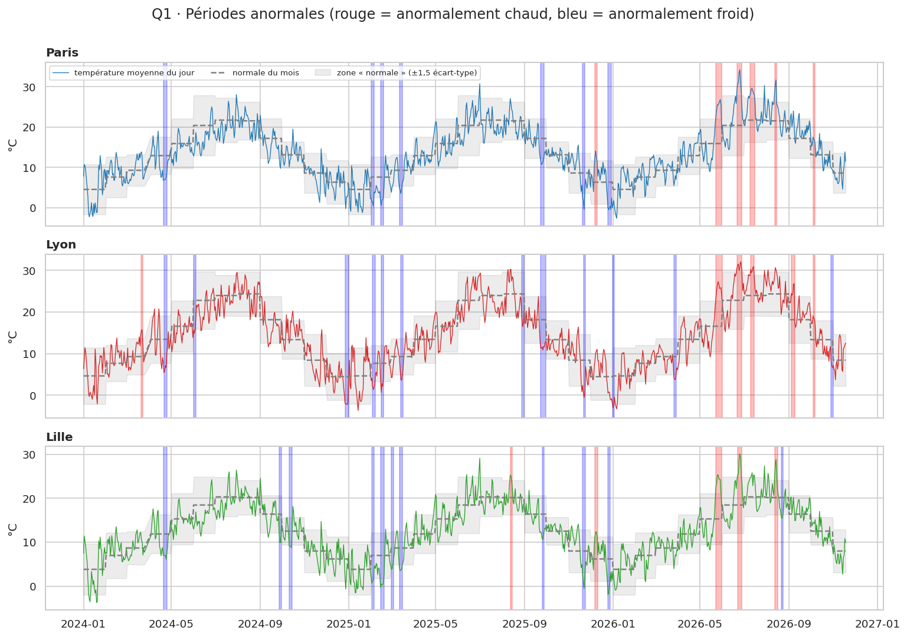
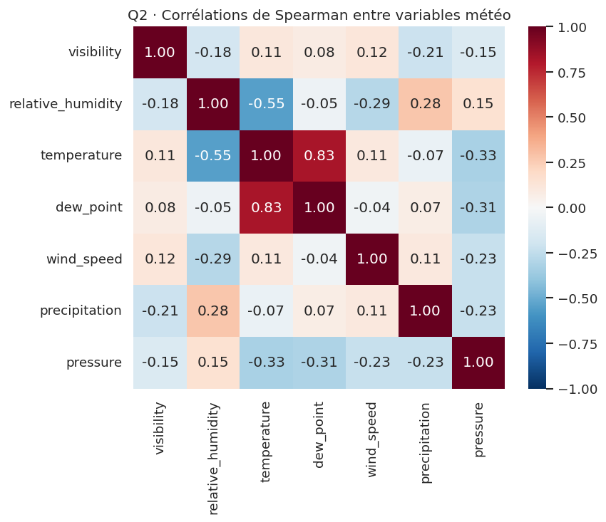
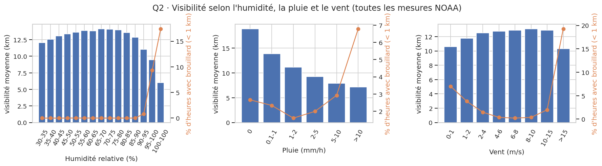
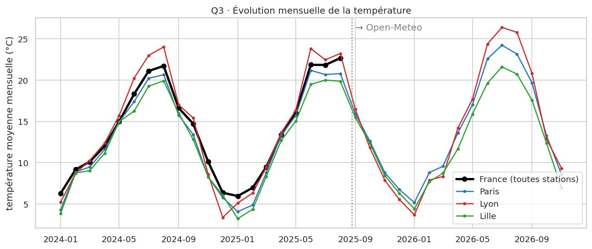
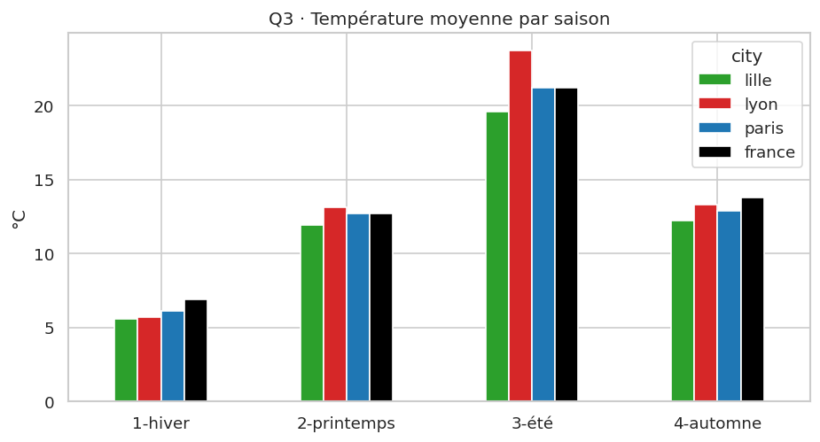
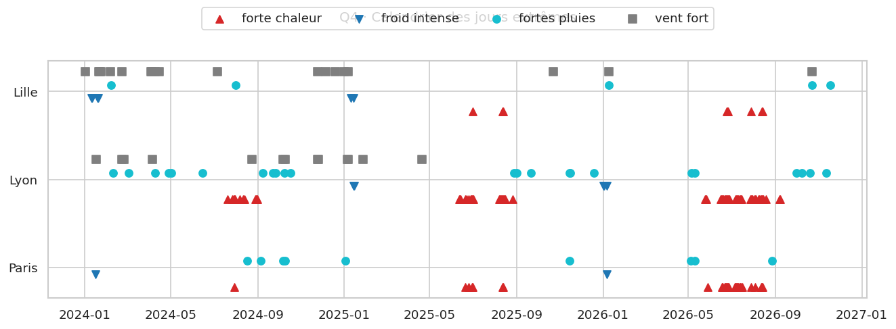

# Partie 1 : analyse météorologique urbaine (flux Batch)

**Auteur :** Développeur 1 · **Notebook :** [`analysis/weather/partie1_meteo.ipynb`](../../analysis/weather/partie1_meteo.ipynb)
· **Pipeline :** [`pipelines/batch_noaa/`](../../pipelines/batch_noaa/)

## En bref

| Question | Réponse courte |
|---|---|
| 1. Périodes anormales ? | **Oui : 47 périodes** de 3 jours ou plus (17 chaudes, 30 froides). Les plus fortes sont les **vagues de chaleur de 2026** (fin mai, fin juin, mi-août : jusqu'à **+10,8 °C** au-dessus de la normale à Paris). Les épisodes froids les plus nets sont **avril 2024** et **février 2025**, qui touchent les 3 villes en même temps. |
| 2. Météo ↔ visibilité ? | **Oui, mais pas linéaire.** La visibilité ne s'effondre qu'au-delà de **90 % d'humidité** : à 100 %, elle est divisée par deux (6 km) et **17 % des heures sont dans le brouillard**. La pluie la réduit aussi (19 km par temps sec, 7 km sous forte pluie). |
| 3. Évolution saisonnière ? | Cycle classique (minimum en janvier-février, maximum en juillet-août). **Lyon a le climat le plus contrasté** (18 °C d'écart été-hiver), **Lille le plus doux** (14 °C), Paris est entre les deux (15 °C). |
| 4. Jours extrêmes ? | **Lyon** est la ville des extrêmes (**76 jours ≥ 33 °C**, 23 jours de fortes pluies). Records : **40,3 °C à Paris le 24/06/2026**, **−7,6 °C à Lille le 19/01/2024**, **79 mm de pluie à Lyon le 28/04/2024**, **tempête Kirk** à Paris le 09/10/2024 (69 mm). |

---

## Données et méthode

| Étape | Ce qui est fait | Volume |
|---|---|---|
| Collecte | `download.py` : téléchargement **parallèle** (16 à la fois, reprises sur erreur) des fichiers NOAA Global Hourly des stations françaises | 2 années utilisées (2024-2025), ~200 stations |
| Nettoyage | `clean.py` (Spark) : décodage des champs NOAA (÷10), valeurs sentinelles (9999…) et codes qualité douteux → `null`, valeurs impossibles rejetées, dédoublonnage SYNOP/METAR, timestamps UTC | **3,5 millions** de mesures, 208 stations |
| Complément | `openmeteo.py` : la NOAA s'arrête le **24/08/2025** ; la vraie météo de Paris, Lyon et Lille est complétée par **Open-Meteo** jusqu'à aujourd'hui | 32 508 heures |
| Agrégation | `curate.py` (Spark) : moyenne par **ville et par heure** (d'abord par station, puis entre stations) → table `weather_city_hourly` (MinIO + PostgreSQL) | **74 661** lignes, 01/2024 → 11/2026 |

Pour l'analyse, les heures sont regroupées par **ville et par jour** (3 108 jours-ville), en gardant
les jours avec au moins 18 heures de mesures.

---

## Question 1 · Peut-on identifier des périodes météorologiques anormales ?

**Méthode.**
1. **Écart à la normale (z-score).** Pour chaque ville et chaque mois, on calcule la température
   habituelle (la normale) et sa variabilité (l'écart-type). Si un jour s'écarte de plus de 1,5 écart-type
   de la normale, il est anormal. Une **période** anormale, c'est au moins 3 jours anormaux de suite.
2. **IsolationForest (IA non supervisée)** sur 6 variables à la fois (température moyenne, maximale et
   minimale, vent, pluie, pression). L'algorithme isole les 2 % de jours qui ressemblent le moins aux autres.

**Résultats.**
* **47 périodes anormales** : 17 chaudes et 30 froides. Lille en compte 16, Lyon 18 et Paris 13.
* **Les épisodes qui touchent les 3 villes en même temps** sont les plus significatifs, car ils
  correspondent à des situations météo de grande échelle :

| Période | Type | Écart à la normale |
|---|---|---|
| 20 → 24 avril 2024 | ❄️ froid tardif de printemps | −5,0 à −7,2 °C |
| 1 → 4 et 14 → 18 février 2025 | ❄️ froid hivernal | −5,7 à −6,6 °C |
| 23 → 29 septembre 2025 | ❄️ fraîcheur précoce | −5,3 à −6,6 °C |
| 20 → 23 novembre 2025 | ❄️ coup de froid | −6,6 à −8,2 °C |
| 23 → 31 mai 2026 | 🔥 chaleur précoce | **+8,6 à +9,4 °C** |
| 21 → 27 juin 2026 | 🔥 **vague de chaleur** | **+8,3 à +10,8 °C** (moyenne journalière de 31 °C à Paris et à Lyon) |
| 9 → 15 juillet et 12 → 15 août 2026 | 🔥 vagues de chaleur | +6,2 à +8,7 °C |

* **IsolationForest** ne détecte pas seulement la chaleur et le froid : les jours les plus inhabituels
  sont surtout des **tempêtes**, avec une pression basse, du vent et de la pluie en même temps :
  * **2 janvier 2024 à Lille** : tempête Henk (992 hPa, vent 15 m/s, 18 mm) ;
  * **9 octobre 2024 à Paris** : tempête Kirk (989 hPa, **69 mm** de pluie) ;
  * **9 janvier 2026 à Lille** : 986 hPa, 24 mm, vent 12 m/s ;
  * des journées glaciales (17-20 janvier 2024 à Lille, −5 à −7 °C la nuit).

**Interprétation.** Oui, on identifie clairement des périodes anormales. Le z-score repère les épisodes
de chaleur ou de froid qui durent ; l'IA repère en plus les **événements combinés**, les tempêtes,
qu'un seuil sur la seule température ne verrait pas. Les deux méthodes sont complémentaires.
**L'été 2026 ressort comme le plus anormal** de la période, avec trois vagues de chaleur successives.

---

## Question 2 · Existe-t-il une corrélation entre conditions météo et visibilité ?

**Méthode.** Mesures horaires des stations NOAA (toute la France ; Open-Meteo ne fournit pas la
visibilité sur la période ancienne).
* Corrélation de **Spearman** sur un échantillon de 159 295 mesures.
* Visibilité moyenne et **part des heures de brouillard** (visibilité < 1 km) par tranche d'humidité,
  de pluie et de vent, calculées par Spark sur **toutes** les mesures.

**Résultats.**

| Variable | Corrélation avec la visibilité |
|---|---|
| Pluie | **−0,21** (plus il pleut, moins on voit loin) |
| Humidité relative | **−0,18** |
| Pression | −0,15 |
| Vent | +0,12 (le vent disperse la brume) |
| Température | +0,11 |

Les corrélations sont **faibles en apparence**, mais les courbes par tranche montrent un lien **très fort
au-delà d'un seuil** :

| Humidité | Visibilité moyenne | Heures de brouillard |
|---|---|---|
| 30 → 85 % | 12 à 14 km (stable) | 0 % |
| 90 → 95 % | 11 km | 0,8 % |
| 95 → 100 % | 9,5 km | 9,3 % |
| **100 % (air saturé)** | **6,0 km** | **17,4 %** |

| Pluie (mm/h) | Visibilité moyenne |
|---|---|
| 0 (sec) | 18,8 km |
| 1 → 2 | 11,2 km |
| 5 → 10 | 7,9 km |
| > 10 | **7,2 km** |

| Vent (m/s) | Heures de brouillard |
|---|---|
| 0 → 1 (calme) | **7,0 %** |
| 4 → 6 | 0,4 % |

**Interprétation.** Il existe bien un lien entre météo et visibilité, mais il est **non linéaire** :
* l'**humidité** n'a presque aucun effet tant que l'air n'est pas proche de la saturation. Au-delà de
  90 %, l'eau se condense en fines gouttelettes : c'est le **brouillard**, et la visibilité chute ;
* la **pluie** réduit la visibilité de façon régulière, jusqu'à 2,6 fois moins par forte pluie ;
* le **vent calme** favorise le brouillard (7 % des heures), le vent modéré le dissipe. Au-delà de
  15 m/s, la visibilité rebaisse : tempêtes avec pluie, ou stations de montagne prises dans les nuages.

Une corrélation unique (Spearman ≈ −0,2) **sous-estime** donc ce lien. De plus, les instruments
plafonnent souvent à 10 km : 55 % des mesures sont à ce plafond. **Les situations à risque pour la
mobilité sont « air saturé + vent calme »**, typiquement les matins d'automne et d'hiver.

---

## Question 3 · Quelle est l'évolution saisonnière de la température en France et dans les principales villes ?

**Méthode.** Température moyenne par mois :
* **France** : moyenne des ~200 stations NOAA, de 01/2024 à 08/2025 ;
* **Paris, Lyon, Lille** : de 01/2024 à 11/2026 (NOAA, puis Open-Meteo).

**Résultats (°C, moyenne de la saison).**

| Saison | Lille | Lyon | Paris | France* |
|---|---|---|---|---|
| Hiver (déc-fév) | 5,6 | 5,7 | 6,1 | 6,9 |
| Printemps (mar-mai) | 11,9 | 13,1 | 12,7 | 12,7 |
| Été (juin-août) | 19,6 | **23,7** | 21,2 | 21,2 |
| Automne (sep-nov) | 12,2 | 13,3 | 12,9 | 13,8 |
| **Écart été − hiver** | **14,0** | **18,0** | 15,1 | 14,3 |

\* France : seulement jusqu'en août 2025 (fin des données NOAA).

**Interprétation.**
* Le **cycle saisonnier** est très net partout : minimum en **janvier-février**, maximum en **juillet-août**.
* **Lyon a le climat le plus contrasté** (18 °C entre l'été et l'hiver) : c'est un climat à influence
  **continentale**, avec les étés les plus chauds des trois villes (23,7 °C) et des hivers aussi froids qu'à Lille.
* **Lille a le climat le plus tempéré** (14 °C d'écart) : climat **océanique**, adouci par la proximité de
  la mer. Ses étés sont les plus frais (19,6 °C).
* **Paris est intermédiaire**, mais avec l'hiver le plus doux des trois villes (6,1 °C). C'est cohérent avec
  l'**îlot de chaleur urbain** d'une très grande agglomération.
* La **moyenne France** suit le même cycle. Elle est plus douce en hiver (6,9 °C), car elle inclut les
  stations du littoral méditerranéen et atlantique.

---

## Question 4 · Quels sont les jours présentant des conditions météorologiques extrêmes ?

**Méthode.** Un jour est extrême s'il dépasse au moins un seuil inspiré des vigilances Météo-France :
**chaleur** t_max ≥ 33 °C, **froid** t_min ≤ −5 °C, **pluie** ≥ 20 mm/jour, **vent** moyen horaire ≥ 12 m/s
(≈ 43 km/h ; les rafales sont bien plus fortes). Liste complète : [`meteo_jours_extremes.csv`](meteo_jours_extremes.csv).

**Nombre de jours extrêmes (01/2024 → 11/2026).**

| Ville | 🔥 Chaleur | 🌧️ Fortes pluies | 🥶 Froid | 💨 Vent fort |
|---|---|---|---|---|
| Lyon | **76** | **23** | 5 | 13 |
| Paris | 32 | 9 | 2 | 0 |
| Lille | 9 | 5 | **6** | **19** |

**Les records de la période.**

| Record | Ville | Date | Valeur |
|---|---|---|---|
| 🔥 Jour le plus chaud | Paris | 24/06/2026 | **40,3 °C** (39,8 °C le lendemain) |
| 🔥 | Paris | 14/08/2026 | 39,1 °C |
| 🔥 | Lyon | 12/08/2025 | 39,0 °C |
| 🥶 Nuit la plus froide | Lille | 19/01/2024 | **−7,6 °C** |
| 🥶 | Lyon | 01/01/2026 | −7,3 °C |
| 🌧️ Jour le plus pluvieux | Lyon | 28/04/2024 | **79 mm** |
| 🌧️ | Lyon | 08/10/2024 | 76 mm |
| 🌧️ | Paris | 09/10/2024 | 69 mm (**tempête Kirk**) |
| 💨 Jour le plus venteux | Lyon | 25/11/2024 | **18 m/s** de vent moyen (≈ 65 km/h) |
| 💨 | Lille | 22/02/2024 | 15,7 m/s |

**Interprétation.**
* **Lyon concentre les extrêmes de chaleur et de pluie** : climat continental et proximité des reliefs,
  qui favorisent les orages et les épisodes de pluies intenses (octobre 2024).
* **Lille concentre le vent fort et le froid** : ville exposée aux tempêtes venues de la Manche et de la mer du Nord.
* **Paris n'a aucun jour de vent fort** : c'est en partie un effet de méthode. La moyenne de 8 stations
  lisse les pointes de vent locales.
* Les jours extrêmes **coïncident avec les périodes anormales de la Q1** : la vague de chaleur de fin juin 2026,
  et les tempêtes Kirk et Henk repérées par IsolationForest.

---

## Limites

1. **Période courte (~3 ans).** Les « normales » de la Q1 sont calculées sur 3 ans, pas sur 30 ans comme les
   normales climatiques officielles : il s'agit d'écarts **à la période étudiée**.
2. **Deux sources météo.** Avant le 25/08/2025, ce sont des **mesures de stations** (NOAA) ; après, des **données
   de modèle** (Open-Meteo, grille de ~10 km), plus lisses, sans visibilité ancienne et sans nombre de stations.
   Une partie des anomalies de 2026 peut venir de ce changement de source. Les épisodes froids détectés
   dans la même période montrent toutefois qu'il n'y a pas de biais systématique vers le chaud.
3. **Précipitations NOAA approximatives.** Les cumuls sur 3 h sont ramenés à l'heure et certaines heures n'ont
   pas de mesure : les cumuls sont sous-estimés. Les jours de fortes pluies restent bien identifiés.
4. **Visibilité plafonnée** par les instruments (10 km pour 55 % des mesures), ce qui affaiblit les corrélations.

## Perspectives

* Avec une collecte continue (le pipeline peut être relancé chaque jour : `openmeteo` puis `curate`), les normales
  deviendraient plus robustes d'année en année.
* La table `weather_city_hourly` est la base de la **partie 4**, pour croiser la météo avec les vélos et la pollution.
